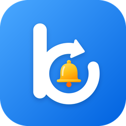

<p align="center">
  
</p>

<h1 align="center">Belloop</h1>

<p align="center">
  Know what's in your kitchen, and use it before it goes off.
</p>

<p align="center">
  
  
  
</p>

---

## Why we made it

We all have that packet of something at the back of the cupboard that we forgot about until it was too late. Most of the time it isn't that we buy too much, it's that we don't remember what we already have, or we remember it the day after it expired.

Belloop is our answer to that. You scan what you buy, the app keeps the list for you, and a few days before something expires it reminds you and suggests real recipes to use it up. We kept it focused on the food you buy in packs (pasta, biscuits, yogurt, sauces...) because that's where a barcode and a printed date make tracking almost effortless.

## What it does


- **Scan the barcode** and Belloop fills in the name, brand and photo from Open Food Facts.
- **Scan the expiry date** printed on the pack with the camera, no typing.
- **Pantry** with everything you have, sorted by date, with search.
- **Reminders** a few days before a product expires (3 by default, you can change it).
- **Home screen** that only shows what needs attention: what's about to expire and what already did ("did you use these?").
- **Recipes** that use the products about to expire, plus anything else you pick from your pantry. Savory or sweet, with the recipes that use exactly your product first.
- **iCloud sync**: your pantry is saved in your own private iCloud and stays the same on all your devices.
- **English and Italian**, recipes included (they're translated on the device).

<br clear="right">

## How it works

| Part | What we use |
|---|---|
| UI | SwiftUI |
| Storage and sync | SwiftData with CloudKit (the user's private database) |
| Barcode and date scanning | VisionKit live scanner, date parsing in `DateParser` |
| Product data | [Open Food Facts](https://world.openfoodfacts.org) API |
| Recipes | [TheMealDB](https://www.themealdb.com) API |
| Matching products to recipe ingredients | Foundation Models (on device), plus Open Food Facts categories |
| Recipe translation | Translation framework (on device) |
| Reminders | Local notifications (`UserNotifications`) |

Everything that reads your food (the camera, the translations, the ingredient matching) runs on the iPhone. The only things that leave the device are the barcode or name you search, sent to Open Food Facts, and the ingredient names sent to TheMealDB.

## Project structure

```
Belloop/
├── FoodSaverApp.swift          app entry point, SwiftData + iCloud container
├── ContentView.swift           the two tabs, Home and Pantry
├── HomeView.swift              what's expiring, what expired, recipe ideas
├── PantryView.swift            the full list, search and sort
├── AddItemView.swift           add a product: scan, search or type
├── ScannerViews.swift          camera scanner for barcodes and dates
├── DateParser.swift            turns "12/05/26", "12 MAG 2026"... into a date
├── OpenFoodFactsService.swift  product lookup and search
├── MealDBService.swift         recipe search, ranking and sweet/savory
├── IngredientNormalizer.swift  product name -> English recipe keyword
├── RecipeSheet.swift           recipe list and recipe detail
├── RecipeTranslator.swift      on-device translation of recipes
├── NotificationManager.swift   expiry reminders
├── ProfileView.swift           profile, iCloud status, country
├── SettingsView.swift          reminder days and other settings
├── Models.swift                the FoodItem model
├── Localizable.xcstrings       English and Italian texts
└── PrivacyInfo.xcprivacy       privacy manifest
```

## Running it

You need a Mac with Xcode and the iOS 27 SDK, and a real iPhone: the camera scanner doesn't work in the Simulator.

1. Clone the repo and open `Belloop.xcodeproj`.
2. In **Signing & Capabilities**, pick your team. If you're not on our team, change the Bundle Identifier and the iCloud container to your own.
3. Sign in to iCloud on the iPhone if you want to try the sync.
4. Run on the iPhone with ⌘R.

## Trying it with TestFlight

We share test builds through TestFlight. If you're a mentor or a friend of the project, ask us for the public link, open it on your iPhone and install Belloop from the TestFlight app.

## Privacy

No account, no tracking, no ads, no analytics. Your pantry lives on your iPhone and in your own iCloud, and we can't see it. The full privacy policy is here: **[atymia.github.io/belloop-privacy](https://atymia.github.io/belloop-privacy/)**.

## Known limits

- Recipes come from TheMealDB, which is mostly English and has more international dishes than Italian ones. We translate them on the device, so some wording can sound a bit literal.
- Product search depends on Open Food Facts. When their server is busy, the search can be slow; scanning the barcode is always the most reliable way.
- Fresh fruit and vegetables without a barcode aren't the focus yet. That's on our list for later.
- We use TheMealDB's free test key. Before a public App Store release we'll need their supporter key.

## Credits

- Product data from [Open Food Facts](https://world.openfoodfacts.org), available under the Open Database License.
- Recipes and photos from [TheMealDB](https://www.themealdb.com).

## The team

Belloop is made by **High Five**, a team of students at the Apple Developer Academy:

Francesco Esposito · Shamima Islam · Alina Siddiqui · Smail Oujaoura · Elbachir El alaoui
