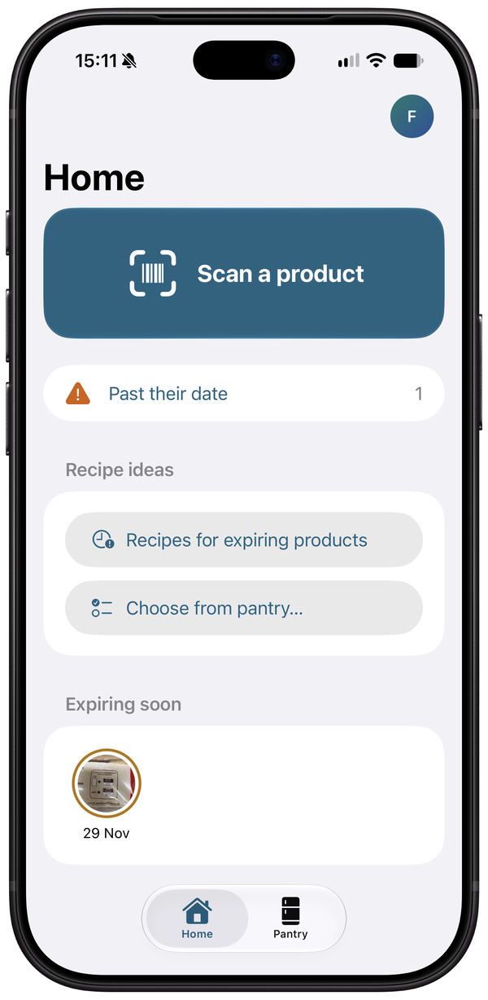

<p align="center">
  
</p>

<h1 align="center">Belloop</h1>

<p align="center">
  Know what's in your kitchen, and use it before it goes off.
</p>

<p align="center">
  
  
  
</p>

---

## Why we made it

We all have that packet of something at the back of the cupboard that we forgot about until it was too late. Most of the time it isn't that we buy too much, it's that we don't remember what we already have, or we remember it the day after it expired.

Belloop is our answer to that. You scan what you buy, the app keeps the list for you, and a few days before something expires it reminds you and suggests real recipes to use it up. We kept it focused on the food you buy in packs (pasta, biscuits, yogurt, sauces...) because that's where a barcode and a printed date make tracking almost effortless.

## What it does



- **One scan for everything.** Tap Scan a product and the camera opens. Point it at the barcode, turn the pack, and the expiry date is read in the same scan, even when it's printed right next to the barcode. Name, brand and photo come from Open Food Facts, and you can still change them before saving. No barcode? Tap Enter manually.
- **Pantry** with everything you have, sorted by date, with search.
- **Reminders at 9:00**: one for what's expiring soon, every morning from 3 days before the date (you can change it) to the day itself, and one the morning after a date to ask, once, if you used the product. With one product you can answer right on the notification. Products you haven't answered for stay under Past their date on Home, with a badge on the app icon, and "Still have it" brings them back the next day. Add something that's already expired and Belloop asks first.
- **A Home that fits on one screen**, however full your fridge is. Expired products sit in one row at the top: tap it and swipe through them, answering one at a time. Then the recipe buttons and the four products expiring soonest, as round photos with their date (tap one to open it), and See all for the rest.
- **Recipes** that use the products about to expire, plus anything else you pick from your pantry. Savory or sweet, with the recipes that use exactly your product first. Anything that expired more than a day ago isn't suggested. Belloop can also read a recipe out loud while you cook.
- **iCloud sync**: your pantry is saved in your own private iCloud and stays the same on all your devices.
- **English and Italian**, recipes included (they're translated on the device).
- **Help inside the app**: a short How to Use guide and answers to the usual questions, in Settings.

<br clear="right">

## How it works

| Part | What we use |
|---|---|
| UI | SwiftUI |
| Storage and sync | SwiftData with CloudKit (the user's private database) |
| Barcode and date scanning | VisionKit live scanner, date parsing in `DateParser` |
| Product data | [Open Food Facts](https://world.openfoodfacts.org) API |
| Recipes | [TheMealDB](https://www.themealdb.com) API |
| Matching products to recipe ingredients | Foundation Models (on device), plus Open Food Facts categories. Names typed by hand are translated by Apple (Foundation Models, or the Translation framework) and checked against TheMealDB's ingredient list |
| Recipe translation | Translation framework (on device) |
| Reminders | Local notifications (`UserNotifications`) |
| Reading recipes out loud | `AVSpeechSynthesizer`, the iPhone's own voices |

Everything that reads your food (the camera, the translations, the ingredient matching) runs on the iPhone. The only things that leave the device are the barcode or name you search, sent to Open Food Facts, and the ingredient names sent to TheMealDB.

## Project structure

```
Belloop/
├── App/
│   ├── BelloopApp.swift            app entry point, SwiftData + iCloud container
│   ├── ContentView.swift           the two tabs and the navigation between screens
│   └── AppSettings.swift           reminder days and the other saved settings
├── Models/
│   └── Models.swift                the FoodItem model and the expiry rules
├── Views/
│   ├── Home/                       Home, the See all list, the review of expired products
│   ├── Pantry/                     the full list, product rows and product detail
│   ├── AddItem/                    the add form and the camera scanner
│   ├── Recipes/                    recipe list, recipe detail, product picker
│   └── Profile/                    account, settings, help and about
├── Services/
│   ├── OpenFoodFactsService.swift  product lookup and search
│   ├── MealDBService.swift         recipe search, ranking and sweet/savory
│   ├── IngredientNormalizer.swift  product name -> English recipe keyword
│   ├── RecipeTranslator.swift      on-device translation of recipes
│   ├── NotificationManager.swift   the 9:00 reminders, the "did you use it?" question, the badge
│   └── DateParser.swift            turns "12/05/26", "12 MAG 2026"... into a date
└── Resources/                      icon and colors, English and Italian texts, privacy manifest
```

## Privacy

No account, no tracking, no ads, no analytics. Your pantry lives on your iPhone and in your own iCloud, and we can't see it. The full privacy policy is here: **[atymia.github.io/belloop-privacy](https://atymia.github.io/belloop-privacy/)**.

## Known limits

- Recipes come from TheMealDB, which is mostly English and has more international dishes than Italian ones. We translate them on the device, so some wording can sound a bit literal.
- Product search depends on Open Food Facts. When their server is busy, the search can be slow; scanning the barcode is always the most reliable way.
- TheMealDB's free test key is only for development. To build with the supporter key, add `Belloop/Resources/Secrets.plist` with a `MealDBKey` string. The file is ignored by git, so the key never ends up in this public repo; without it the app falls back to the test key.

## Credits

- Product data from [Open Food Facts](https://world.openfoodfacts.org), available under the [Open Database License](https://opendatacommons.org/licenses/odbl/1-0/).
- Recipes and photos from [TheMealDB](https://www.themealdb.com).

## The team

Belloop is made by **High Five**, a team of students at the Apple Developer Academy:

- [@atymia](https://github.com/Atymia)
- [@smailoujaoura](https://github.com/smailoujaoura)
- [@AlinaSiddiqui](https://github.com/AlinaSiddiqui)
- [@shamimaislamedu-eng](https://github.com/shamimaislamedu-eng)
- [@AdamGreek001](https://github.com/AdamGreek001)

## License

Belloop is released under the [Apache License 2.0](LICENSE).
